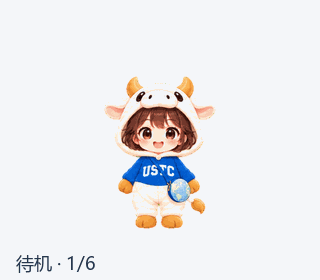

# 科哞哞——Codex 桌宠

**科哞哞**（Ke Mou Mou）是一位穿着奶油白小牛连帽装、蓝色 USTC 上衣、背着地球挎包的卡通女孩，作为中国科学技术大学本科科研实践平台的互动形象而设计。本项目同时包含她的 **Codex 桌宠**实现——一个可以悬浮在网页上的动画小伙伴，陪伴你浏览、工作和学习。


---

## 目录

- [设计思路](#设计思路)
- [角色设定](#角色设定)
- [动画状态](#动画状态)
- [项目结构](#项目结构)
- [部署 Codex 桌宠](#部署-codex-桌宠)
- [AI 辅助创作说明](#ai-辅助创作说明)
- [所有权与使用声明](#所有权与使用声明)

---

## 设计思路

### 灵感来源

"科哞哞"的名字取自"科大"的"科"与牛叫声"哞哞"的叠音，亲切而便于记忆。角色设计灵感来源于中国科学技术大学校园中广受喜爱的"科小牛"文创形象及"孺子牛"校园雕塑——小牛推动地球的意象，象征着求知与探索。

### 造型语言

- **奶油白牛头套**与**金色牛角**：呼应科大"科小牛"的视觉记忆，毛绒质感传递温暖
- **蓝色上衣与 USTC 字样**：建立学校关联，深蓝代表沉静与严谨
- **地球斜挎包**：延续"牛与世界"的校园联想，象征面向世界的好奇心
- **棕色短发与大眼**：保持学生般的好奇与亲切感
- **大头与紧凑身体**（约 2.8 头身）：强化卡通感，适合小尺寸显示
- **毛绒领口贴合下巴**：不露出脖子，让角色显得温暖而有安全感

### 从角色到桌宠

角色设计完成后，我们将科哞哞适配为 Codex 桌宠格式：保留全部视觉特征，将角色绘制在 192x208 像素的单元格中，使用绿幕抠像（chroma key #00FF00）提取透明背景，最终拼接为精灵图表（spritesheet）。桌宠版本支持 11 种动画状态，包括待机、奔跑、跳跃、挥手、出错、等待、思考、检查成果以及 16 方向视线跟随。

---

## 角色设定

| 属性 | 描述 |
| --- | --- |
| 名称 | 科哞哞（Ke Mou Mou） |
| 身份 | 本科科研实践平台的亲切伙伴 |
| 性格 | 好奇、耐心、善于引导 |
| 造型 | 穿着牛玩偶服的可爱女孩 |
| 配色 | 奶油白 + 深蓝 + 金色 + 棕色 |
| 配件 | 金色牛角、蹄形手套、地球挎包、蓝色 USTC 上衣 |
| 使命 | 陪伴同学从一次提问、一本资料、一场讲座开始探索科研 |

### 平台功能动作

| 动作 | 使用场景 |
| --- | --- |
| 欢迎 | 首页欢迎与新手引导 |
| 找导师 | 展示导师信息卡 |
| 找项目 | 手持勾选清单，提示研究方向 |
| 找资源 | 坐姿阅读，提示教程资料 |
| 看成果 | 展示图表，分享研究进展 |
| 看通知 | 手持扩音器，提示活动通知 |
| 听讲座 | 持笔记录，强调倾听学习 |
| 组队招募 | 张开双臂，邀请伙伴加入 |
| 思考 | 托腮与思考气泡，用于咨询等待 |

---

## 动画状态

Codex 桌宠版本的科哞哞支持以下动画状态：

| 状态 | 帧数 | 描述 |
| --- | --- | --- |
| `idle` | 6 | 安静陪伴，轻轻呼吸和眨眼 |
| `running-right` | 8 | 向右拖动时奔跑 |
| `running-left` | 8 | 向左拖动时奔跑 |
| `waving` | 4 | 打招呼，蹄形手套轻轻挥手 |
| `jumping` | 5 | 开心跳跃，蓄力、起跳、腾空、落地 |
| `failed` | 8 | 出错时委屈大哭，张嘴流泪 |
| `waiting` | 6 | 等待输入，双手靠拢抬头期待 |
| `running` | 6 | 认真思考，双脚站稳托腮 |
| `review` | 6 | 检查成果，低头观察地球挎包 |
| `look-row-9` | 8 | 视线跟随：顺时针上半圈（8个方向） |
| `look-row-10` | 8 | 视线跟随：顺时针下半圈（8个方向） |

最终精灵图：`sprites/final/spritesheet-extended.png`，1536x2288 像素，73 帧，11 行 x 8 列，每格 192x208 像素。



---

## 项目结构

```
kemoomoo-codex-pet/
+-- README.md                        # 本文件
+-- LICENSE                          # 所有权与使用声明
+-- DESIGN.md                        # 详细设计文档
+-- DEPLOYMENT.md                    # 部署指南
|
+-- design/                          # 角色原始设计素材
|   +-- 概念图/                      # 三版概念图及创作记录
|   +-- 主形象/                      # 最终选定的主形象
|   +-- 动作延展/                    # 九种动作独立图
|   +-- 网站演示/                    # 网页悬浮助手预览与动作轻动画
|   +-- 03_科哞哞_九种场景展示.png   # 九宫格动作总览
|   +-- 05_角色设计说明.txt
|   +-- 06_AI使用及参考素材披露.txt
|
+-- sprites/                         # Codex 桌宠精灵图素材
|   +-- final/                       # 最终精灵图与结构校验报告
|   +-- frames/                      # 九种动作状态的独立帧（视线跟随帧见 decoded/）
|   +-- decoded/                     # 各状态原始生成图
|   +-- references/                  # 参考图与布局引导
|   +-- prompts/                     # 生成提示词
|   +-- qa/                          # 质量检查与平台预检报告
|   +-- 制作记录/                    # 抠图、拼接与校验脚本
|   +-- 动画预览/                    # GIF/MP4 预览
|   +-- pet_request.json             # 桌宠请求配置
|   +-- 制作说明.md
|
+-- web/                             # 网页部署实现
    +-- pet.js                       # 桌宠 JavaScript 逻辑
    +-- pet.css                      # 桌宠样式
    +-- pet/
        +-- spritesheet.webp         # 压缩后的精灵图
        +-- spritesheet.png
        +-- scenes.json              # 场景配置
        +-- cutouts/                 # 场景抠图
        +-- scenes/                  # 场景图
```

---

## 部署 Codex 桌宠

### 方法一：集成到现有网站

1. 将 `web/` 目录复制到你的网站资源目录：
   ```
   your-site/
   +-- assets/
       +-- pet.js
       +-- pet.css
       +-- pet/
           +-- spritesheet.webp
           +-- spritesheet.png
           +-- scenes.json
           +-- cutouts/
           +-- scenes/
   ```

2. 在 HTML 页面的 `<head>` 中引入样式：
   ```html
   <link rel="stylesheet" href="assets/pet.css">
   ```

3. 在 `</body>` 前引入脚本：
   ```html
   <script src="assets/pet.js" defer></script>
   ```

4. 桌宠会自动初始化，显示在页面右下角。

### 方法二：本地预览

使用本地服务器：
```bash
# 使用 Python
cd web && python -m http.server 8080

# 使用 Node.js
npx serve web
```

### 自定义

- **修改 `pet.js` 中的 `pageProfile` 函数**：根据你的网站页面路径配置桌宠在不同页面的姿态和介绍语
- **修改 `SCENES` 数组**：自定义场景标签和描述文字
- **调整 `scale` 默认值**：改变桌宠初始大小
- **修改 `keys` 中的 localStorage 键名**：避免与其他站点冲突

详细的部署和自定义说明请参阅 [DEPLOYMENT.md](DEPLOYMENT.md)。

---

## AI 辅助创作说明

本项目的角色设计和桌宠制作均使用了 **OpenAI Codex** 的内置 imagegen 工具辅助完成：

- **角色概念图**：使用 imagegen 根据文字提示词生成角色插画，经多轮人工选择和修改确定最终造型
- **动作延展**：以选定主形象为参考，AI 辅助生成九种科研平台场景动作
- **桌宠精灵图**：逐状态使用 imagegen 生成动画帧，再通过脚本完成抠图、帧提取、拼接与校验
- **文字说明**：设计文档和说明文字由 AI 辅助起草，经作者最终审阅

完整提示词保存在 `sprites/prompts/` 和 `design/概念图/` 目录中。

---

## 所有权与使用声明

### 版权声明

**"科哞哞"角色形象及其全部衍生素材（包括但不限于插画、精灵图、动画、配置文件）的著作权归原作者（yxycutus / Cutus）所有。**

### 角色关联声明

本角色设计受中国科学技术大学校园"科小牛"文创形象启发，与其配色及服饰存在有意关联。"科哞哞"为独立创作的提案角色，并非学校官方形象。本提案未使用完整校徽，不代表已取得相关形象改编许可，也不代表主办方已确认满足原创性要求。

### 使用许可

| 用途 | 是否允许 |
| --- | --- |
| 个人学习与研究 | 允许 |
| 非商业引用与展示（需署名） | 允许 |
| 商业使用 | 需事先获得作者书面授权 |
| 修改与衍生 | 允许，但须保留原始署名并注明修改 |
| 重新分发原始素材 | 需保留本声明，且不得用于商业目的 |

### 署名方式

使用本角色形象或其衍生素材时，请以以下方式之一署名：

> 科哞哞 by yxycutus / Cutus

或链接至本仓库：`https://github.com/yxycutus/kemoomoo-codex-pet`

### 免责声明

本项目按"原样"提供，不附带任何明示或暗示的保证。使用本项目中的素材和代码所产生的一切后果，由使用者自行承担。作者不对因使用本角色形象而可能引发的任何版权、商标或其他法律争议负责。

---

## 参考资料

- 科大基金会"科小牛"文创形象：https://ef.ustc.edu.cn/info/1084/1646.htm
- 孺子牛校园雕塑介绍：https://po.ustc.edu.cn/2023/0626/c19252a607012/pagem.htm
- 学校视觉标识相关介绍：https://sz.ustc.edu.cn/wdxz_show/13.html

---

## 致谢

角色设计灵感来源于中国科学技术大学校园文化。感谢 OpenAI Codex 提供的 AI 辅助创作能力。

---

*科哞哞——陪你从一个好问题，走进科研。*
